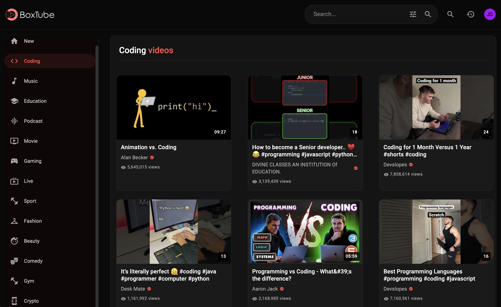

# Boxtube

A calmer, faster way to watch YouTube, as native apps for **iPhone** and **Mac** (Swift 6 + SwiftUI).
The original React web app is still here too: see [The web app](#the-web-app).

## What's different

- **Island navigation (iPhone):** Home, Shorts, Subscriptions, Playlists and You live in a floating island at the bottom, with a mini player that grows into chapter scrubbing.
- **Chapters everywhere:** segmented scrubbers, a chapter ring (long-press the mini player), and Skim (pinch the video) to see every chapter at once.
- **Time box:** say how long you have and Boxtube fills it with whole videos or single chapters from your subscriptions. Also a Home Screen and lock-screen widget.
- **Notes on the video:** press N (Mac) to pin a note to the current moment; export as Markdown.
- **Colours from the video (Mac):** the window takes its palette from what you're watching.
- **Keyboard first (Mac):** ⌘K command palette, J/K/L, chapters with C, and `?` for every shortcut.
- **Calm mode:** no counts, no badges, no autoplay pressure.
- **Music mode:** a Spotify-style library and Now Playing for music channels and playlists.
- **Your library:** sign in with Google to bring in your subscriptions, playlists and likes (read-only). Without signing in, subscriptions work from free channel feeds.
- **Lock screen:** a Live Activity with chapter progress and ±10 s, plus normal Now Playing controls.

Videos play through YouTube's official embedded player, so YouTube's rules apply (for example, no background play).

## Run it

You need a Mac with **Xcode 27** and [XcodeGen](https://github.com/yonaskolb/XcodeGen) (`brew install xcodegen`). A free Apple ID is enough to put it on your own iPhone.

```bash
git clone https://github.com/razeenwasif/boxtube.git
cd boxtube/apple
cp Config/Secrets.example.xcconfig Config/Secrets.xcconfig   # then fill it in (below)
scripts/install.sh            # builds and installs on your iPhone and in /Applications
```

`scripts/install.sh iphone` or `scripts/install.sh mac` does just one. The iPhone must be paired with this Mac (connected once by USB and trusted), unlocked, and in Developer Mode.

To work in Xcode instead: `xcodegen generate`, then open `Boxtube.xcodeproj` (it's generated, so it isn't in git).

### Free Apple ID limits

- Apps you install expire after **7 days**. Rerun `scripts/install.sh iphone` before then; it prints the date. Your library and notes are kept.
- At most 3 of your own apps on a device at once.
- No SharePlay (Watch together); that needs a paid developer account.

## Configuration

Everything private goes in `apple/Config/Secrets.xcconfig`, which git ignores. Each part is optional.

### Signing (if you're not Razeen)

Set your team id (Xcode → Settings → Accounts) and a bundle id of your own:

```
BOXTUBE_TEAM = ABCDE12345
BOXTUBE_BUNDLE_ID = com.yourname.boxtube
```

### YouTube Data API key: search, durations, topics

Without it, subscriptions still work through free RSS feeds.

1. In [Google Cloud Console](https://console.cloud.google.com), create a project and enable **YouTube Data API v3**.
2. APIs & Services → Credentials → **Create credentials → API key**. Restrict it to the YouTube Data API.
3. Add `YOUTUBE_API_KEY = …` to `Secrets.xcconfig`.

### Google sign-in: your subscriptions, playlists and likes

1. In the same project, open **Google Auth Platform** (OAuth consent screen). Choose **External** and leave it in **Testing**.
2. Under **Audience**, add your Gmail address as a **test user**.
3. Under **Data access**, add the scope `.../auth/youtube.readonly`.
4. **Clients → Create client → Desktop app**, then copy the client id and secret into `Secrets.xcconfig`:

```
GOOGLE_CLIENT_ID = 1234-abc.apps.googleusercontent.com
GOOGLE_CLIENT_SECRET = GOCSPX-…
```

Then use **Sign in with Google** (Mac: Settings or ⌘K; iPhone: the You tab).

- **Read-only:** likes, subscriptions and playlist edits you make in Boxtube stay in Boxtube.
- **Weekly sign-in while in Testing:** Google ends the sign-in after 7 days. Boxtube asks you to sign in again.
- **No Watch later:** YouTube doesn't let apps read the Watch later list.
- **Music playlists:** playlists that are mostly music go to Music mode automatically. Use **Show in Music** on a playlist or channel to change it.

### Quota

The daily allowance is 10,000 units. A typical day uses well under 1,000.

| What | Cost |
|---|---|
| Subscriptions feed | free (RSS) |
| Video details, 50 at a time | 1 |
| Importing your library | about 10–40 |
| A search | 100 |

## Project layout

```
apple/
  project.yml              XcodeGen spec
  Config/                  build settings; Secrets.xcconfig (git-ignored)
  Packages/BoxtubeKit/     shared code: models, API, RSS, database (GRDB), player, design system
  Boxtube/                 the app: App/, iOS/, macOS/, Shared/
  BoxtubeWidgets/          Live Activity and the Time box widget
  BoxtubeUITests/          a scriptable UI driver used to test on a real iPhone
  scripts/install.sh       build and install
```

[`apple/IMPLEMENTATION_PLAN.md`](apple/IMPLEMENTATION_PLAN.md) explains the architecture and data sources.

## The web app

The original Boxtube is a React + Material-UI site built on the YouTube Data API v3. It's live at
[boxtube.netlify.app](https://boxtube.netlify.app/). To run it locally:

```bash
npm install
REACT_APP_RAPID_API_KEY=… npm start
```


